# 朕即天下 · 皇朝 Agent 系统

以唐朝前期「三省六部 + 政事堂 + 御史台」为组织模型的多 Agent 持续运行系统，基于 [pi agent](https://github.com/earendil-works/pi)（`@earendil-works/pi-agent-core` / `pi-ai`）。
**你是皇帝。** 46 位官员各是一个独立、持续运行的 Agent，分属 11 个部门。每个部门运行在独立的 Docker 容器里。

```
皇帝 ⇄ 政事堂议事 → 颁旨 → 中书起草（侍郎复署）→ 门下审核（封驳/谏诤）→ 尚书分派 → 六部执行（核验）→ 复奏 → 御览
                                   御史台稽查百官 · 吏部配置与科举 · 户部预算与人事
```

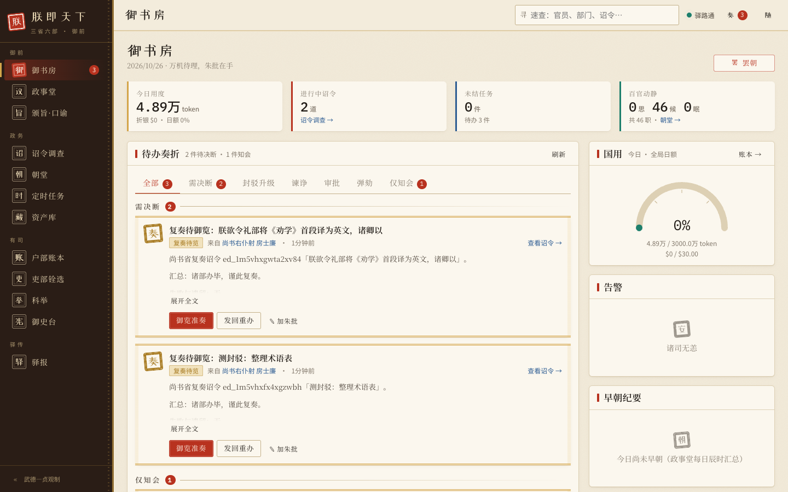

## 快速开始

需要 Node.js ≥ 24 和 Docker（含 Compose v2）。

```bash
npm install
scripts/court.sh init        # 生成 .env（随机 token、自动发现 ~/.pi/agent/auth.json）
scripts/court.sh mock-up     # 零成本：确定性 mock 大脑跑通全流程
# 或
scripts/court.sh up          # 真实模型（默认 opencode-go/deepseek-v4.1-flash）
open http://127.0.0.1:8001   # 皇帝视角 Web
```

不用 Docker 的进程内运行（开发/演示）：

```bash
npm -w @court/web run build
npx tsx scripts/dev-court.ts          # mock 模式，http://127.0.0.1:8001
npx tsx scripts/smoke-real.ts         # 真实模型冒烟：一道小圣旨走完全流程
```

## 界面一览

<table>
<tr><td width="50%">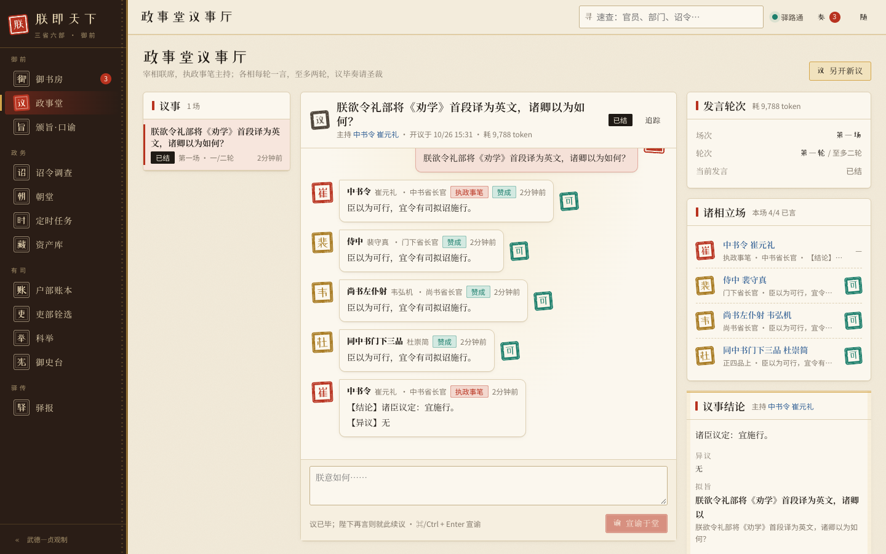<br><sub>政事堂：宰相议事，照准颁旨</sub></td><td width="50%">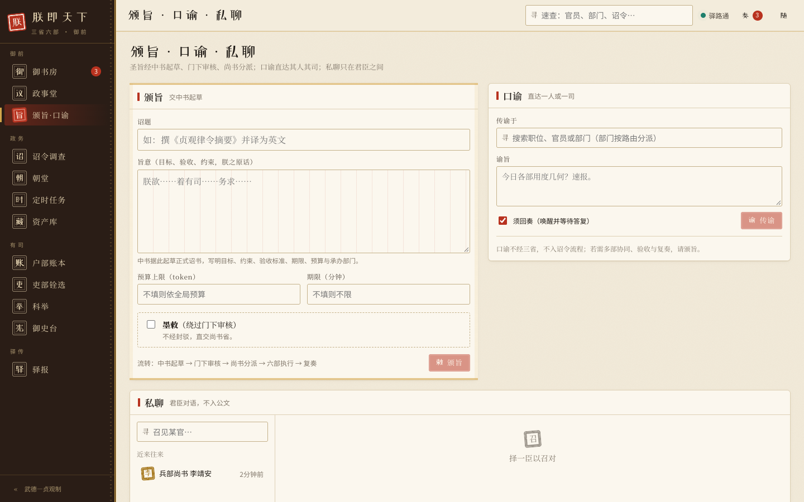<br><sub>颁旨 · 口谕</sub></td></tr>
<tr><td width="50%">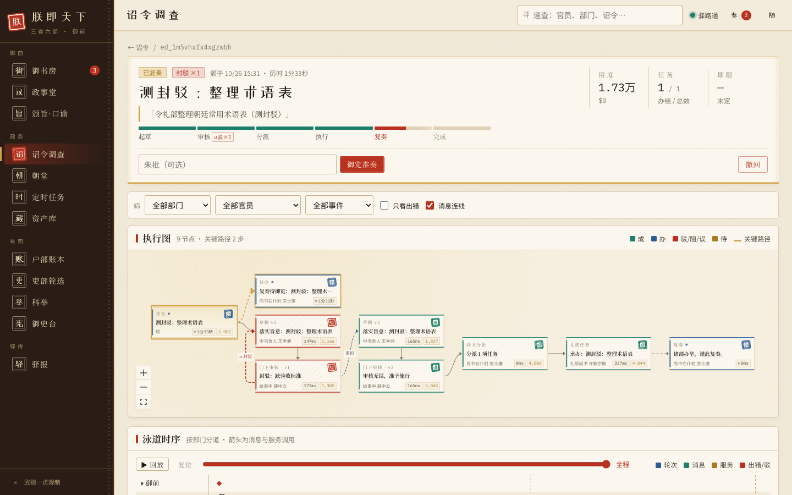<br><sub>诏令调查：执行图与泳道时序</sub></td><td width="50%">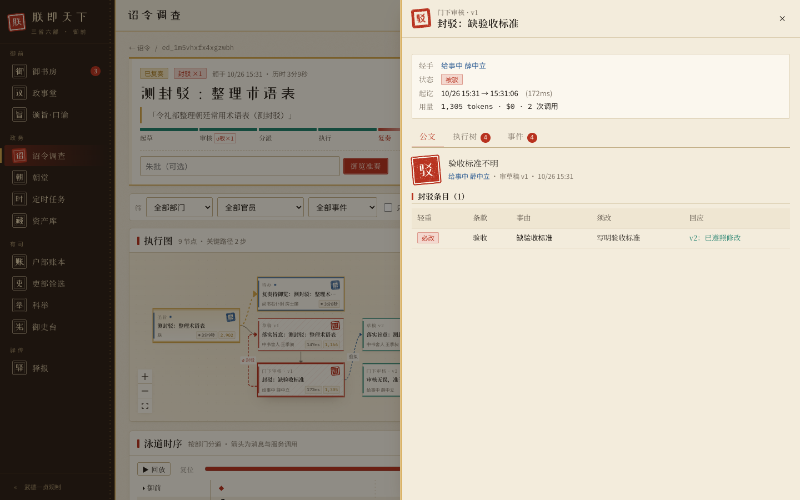<br><sub>诏令调查：节点详情</sub></td></tr>
<tr><td width="50%">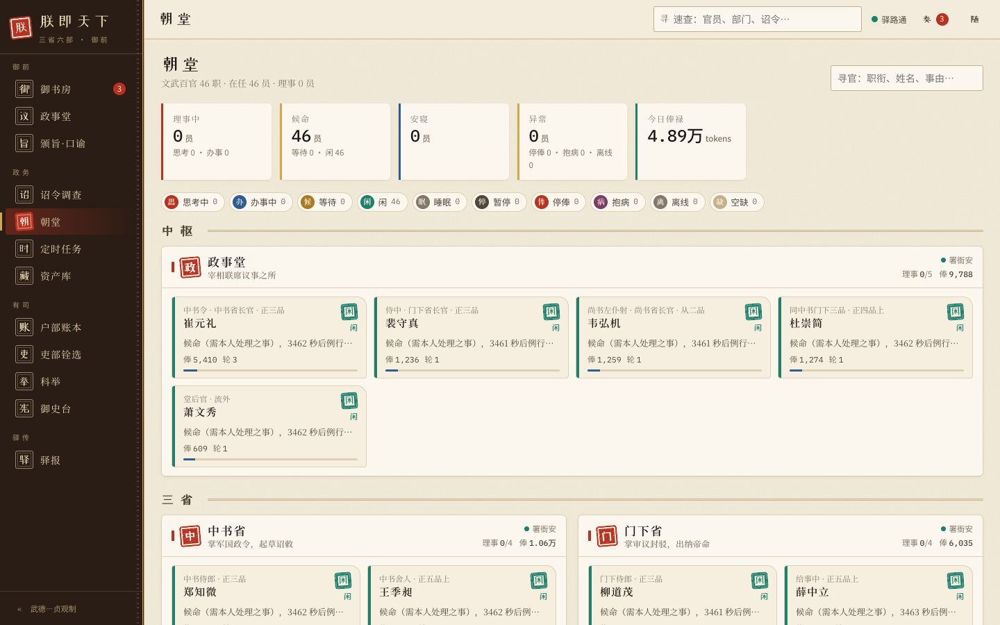<br><sub>朝堂：百官实时状态</sub></td><td width="50%">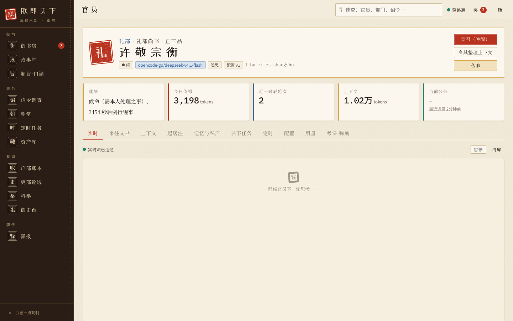<br><sub>官员页：上下文、日志、宣召</sub></td></tr>
<tr><td width="50%">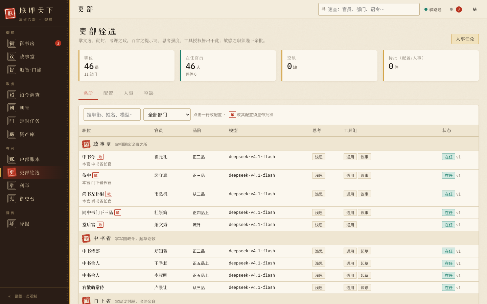<br><sub>吏部铨选：配置与换模型</sub></td><td width="50%">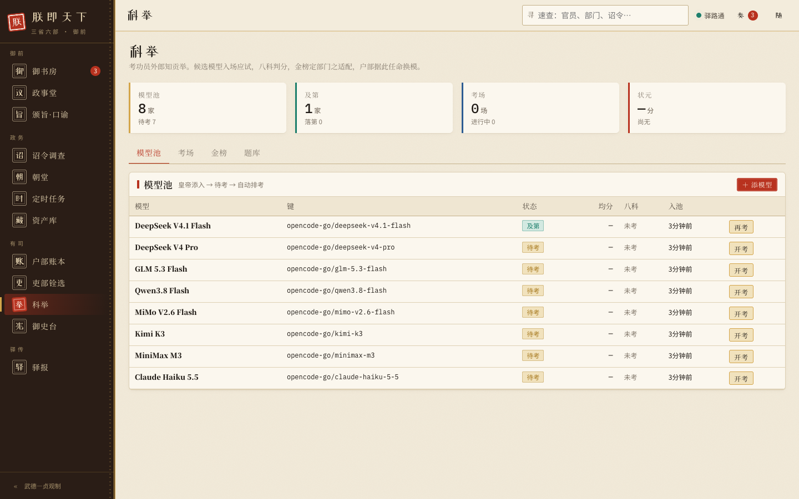<br><sub>科举：模型考试与金榜</sub></td></tr>
<tr><td width="50%"><br><sub>户部账本：用度与预算</sub></td><td width="50%">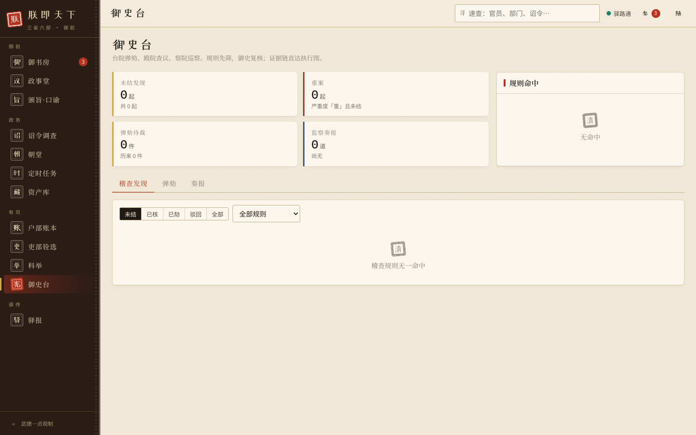<br><sub>御史台：稽查与弹劾</sub></td></tr>
<tr><td width="50%">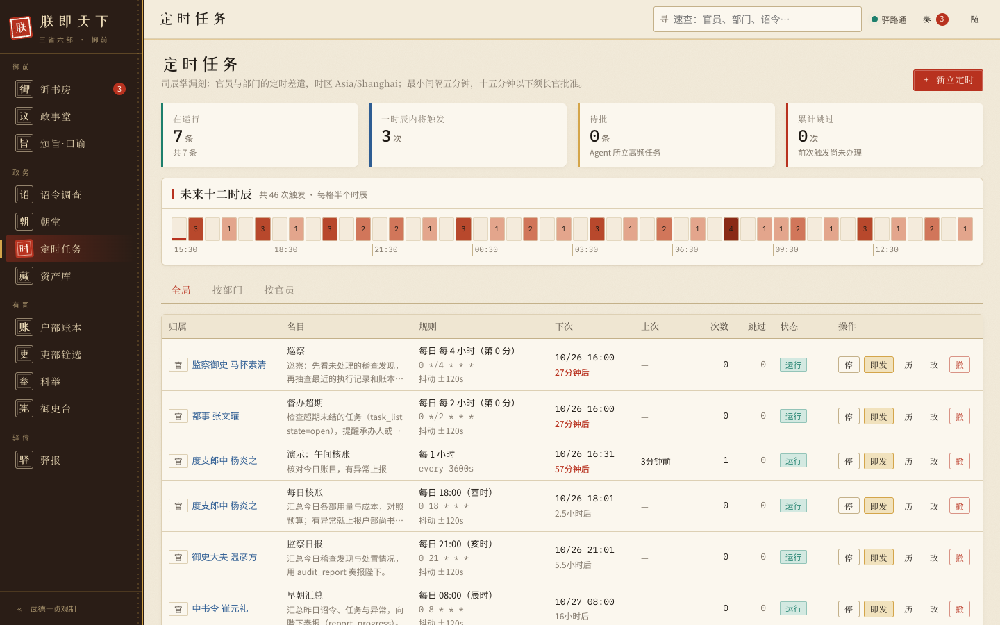<br><sub>定时任务</sub></td><td width="50%">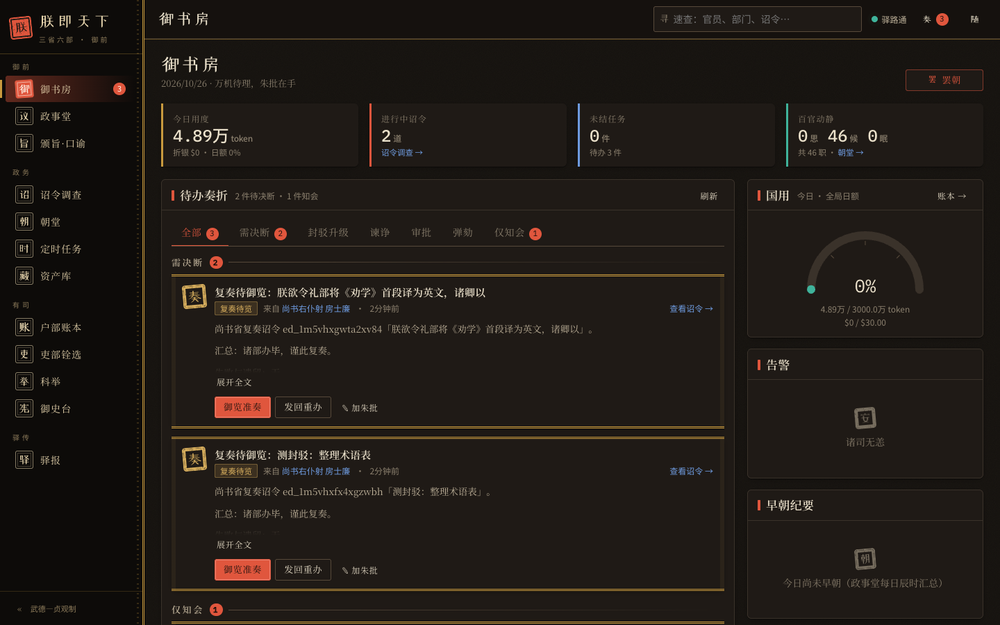<br><sub>深色主题</sub></td></tr>
</table>

## 架构

| 容器 | 作用 |
|---|---|
| `hub`（皇城） | 唯一真相源（SQLite WAL）：名册、消息、诏令/任务状态机、待办、定时任务、资产、账本、科举、稽查、追踪；SSE；看门狗。内部端口 8000（必须带 token），皇帝/Web 端口 8001（只发布到本机） |
| `gateway`（LLM 网关） | 唯一的 LLM 出口：注册 pi 全部内置提供商与自定义提供商，持有凭据（设置页配置），负责限流、熔断、预算检查和记账；兼容 pi-agent-core 的 `streamProxy`；`LLM_MODE=mock` 时启用确定性 mock 大脑 |
| `sandbox`（将作监） | 兵/工/刑部的命令执行与网页抓取：不持有密钥，不接入朝廷网络，各工作区按 uid 隔离 |
| `dept-*` ×11 | 部门 runtime：运行本部门的全部官员 Agent，对外提供部门 API 和每位官员的 API |

要点（详见 `docs/design.md`）：
- **投递**：消息先写入 hub（幂等），hub 再给收件部门「按门铃」；收件方按 cursor 拉取。只有当轮会话持久化之后才推进 cursor，因此不丢消息、也不会重复处理。
- **持续运行**：每位官员有自己的主循环，可以用 `sleep`、`wait_for`（必须带超时）、`whats_happening`（发生什么事了）、`compact_memory`（自我整理）控制自己。超时醒来时如果没有待办，就在代码层继续睡，**不调用 LLM**。
- **防风暴**：hub 强制执行唤醒规则、对话来回上限、跳数上限、客套过滤和议事协议。
- **防卡死**：hub 看门狗按租约过期改派，按 SLA 逐级上报：承办人 → 长官 → 都事/政事堂 → 皇帝。
- **工具**：114 个交流/职能工具，按职位的工具组授予，hub 侧二次校验 ACL。
- **日志**：每位官员的操作日志写在 `data/officials/<id>/logs/YYYY-MM-DD.jsonl`；会话在 `session.jsonl`（崩溃可恢复）。

## 目录

```
config/court.yaml     名册（部门、职位、路由、服务、工具组、默认定时任务）
config/models.yaml    模型池、阅卷模型、部门适配权重
packages/shared       领域类型、API 契约与客户端、工具组
packages/hub          皇城
packages/gateway      LLM 网关 + mock 大脑
packages/dept         部门 runtime + 官员工具（tools/）
packages/sandbox      将作监沙箱
packages/web          皇帝视角 Web（React）
tests/                进程内端到端测试（整座朝廷）
scripts/              构建、compose 生成、部署助手、冒烟与 Docker 端到端
docs/                 设计、计划、pi 调研、截图
```

## 测试

```bash
npx tsc -p tsconfig.json --noEmit
npx vitest run                         # 单元测试 + 进程内端到端（mock）
npx tsx scripts/e2e-docker.ts          # 对 docker mock-up 的端到端 + 混沌测试（重启容器、停 hub）
npx tsx scripts/smoke-real.ts          # 真实模型
```

## 常用操作

- **议事**：Web「政事堂」发言 → 宰相们按序议论 → 主持人总结 → 你点「照准颁旨」。
- **颁旨**：在「颁旨·口谕」页直接颁旨（勾选「墨敕」可跳过门下）。
- **口谕/私聊**：直接给任意官员或部门下命令，或者私下对话。
- **待办**：「御书房」集中显示议事结论、谏诤、封驳升级、复奏、审批、弹劾、预算熔断等。
- **罢朝**：「御书房」右上角的急停开关，暂停全体官员和网关。
- **模型提供商**：在「设置」页配置 pi 支持的任一提供商（Anthropic、OpenAI、Google、DeepSeek、OpenRouter、Groq、xAI、Mistral、Moonshot、智谱、通义、opencode 等约 41 家）：填 API 密钥，或走订阅登录（OAuth：打开授权链接，把回调网址/授权码粘回即可）；也可新增自定义的 OpenAI / Anthropic / Google 兼容服务（含本地 Ollama、vLLM）。密钥只存网关的 `data/gateway/credentials.json`（0600），不会回传浏览器；也可把 `ANTHROPIC_API_KEY=…` 之类写进 `.env.providers`（网关容器自动读取，设置页所存优先）。需要代理时在 `.env.providers` 里设 `HTTPS_PROXY`。（`OPENCODE_API_KEY` 例外：它由 `.env` 注入，写在 `.env.providers` 里会被覆盖。）
- **科举**：在「科举」页从已配置的提供商中选模型入池，系统自动排考；金榜会给出各部门的适配度，户部据此任命（「吏部」页「换模型」）。
- **定时任务**：在「定时任务」页为任何官员或部门建 cron / 间隔 / 一次性任务。

## 许可证

[MIT](LICENSE)
